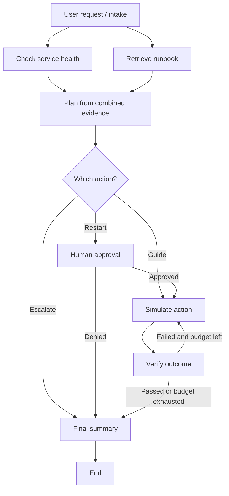

# Agentic Orchestration and Multi-Step Workflows

**Companion file:** `agentic_orchestration_demo.py` — the complete runnable, line-by-line annotated Python implementation. All application code is kept in that file. The small terminal commands below are only for installation and running the workshop.

**Teaching approach:** One familiar enterprise problem is used throughout. Concepts are introduced using a picture and an analogy, followed by a code walkthrough, controlled demonstrations, and participant exercises. This is a **single agentic workflow with an optional LLM planner**, not a demonstration of multiple autonomous agents. The distinction is intentional.

### Assumption
- Participants can read basic Python functions, dictionaries, and conditional statements. Deep knowledge of AI frameworks is **not** required.
- Participants have Python 3.11 or later, a terminal, and an editor such as VS Code.
- The **default demo works without an API key**. In this mode, a transparent rule-based planner stands in for the language model so learners can focus on orchestration.
- An optional **live** mode uses `ChatOpenAI` through LangChain to select a structured plan. That mode requires a valid model API key, network access, and may incur API charges. Live mode is the AI-assisted variant; demo mode demonstrates the same graph mechanics without model inference.
- All dashboard information, runbooks, and remediation outputs are **simulated**. The script never modifies production infrastructure, sends email, or creates a real ticket.

---

## 3. Segment 1 — Why agentic orchestration? (00:00–00:10)

### Opening scenario: a VPN outage

Imagine an enterprise employee reports:

> “Many employees cannot connect to the VPN. Please investigate and fix it.”

A standard chat interaction might answer: “Try restarting the VPN client” or “Check whether the gateway is down.” That can be useful advice, but **it does not coordinate a business process**. A real enterprise response often requires information from different systems, a decision, an approval, and a verification step.

Ask participants: **“What must happen between receiving this request and closing the incident?”**

Expected responses:

1. Identify the affected service and the incident scope.
2. Check current service health.
3. Retrieve operating guidance or a runbook.
4. Decide what action is reasonable based on evidence.
5. Obtain approval before a potentially disruptive change.
6. Perform or propose the action.
7. Check whether the action worked.
8. Retry within safe limits or escalate.
9. Communicate the outcome and retain an audit trail.

**Key statement for learners:** Orchestration is the coordination layer that decides **what step runs, with what data, under which conditions, and what should happen next**.

### Analogy: airport operations

A pilot cannot simply ask “Can we take off?” and act on the first answer. Airport operations coordinate flight planning, weather, maintenance, gate assignment, clearance, and sometimes a hold. Some checks can occur together; others depend on earlier results. The same pattern occurs in AI-assisted workflows.

### Three quick comparisons

| Approach | What it does | Example | Main limitation |
|---|---|---|---|
| Single LLM prompt | Produces one answer from available context. | “What are the possible VPN causes?” | No durable multi-step execution or governed actions by itself. |
| Conventional workflow | Executes mostly predetermined tasks and branches. | Health check → fixed rule → create ticket. | Cannot necessarily reason about ambiguous evidence. |
| Agentic workflow | Uses an LLM or other decision-maker within an orchestrated, tool-using process. | Gather evidence → propose an action with an LLM → enforce approval → verify. | Needs explicit constraints, evaluation, and operational oversight. |

**Important nuance:** A graph with a deterministic planner is still a valuable *workflow*, but a language-model-driven decision is what makes the live version **AI-assisted/agentic**. “Multi-step,” “agentic,” and “multi-agent” are not synonyms.

“Which of these steps should AI decide, and which should enterprise policy decide?”

Recommended answer: AI may help **interpret evidence and propose a plan**; enterprise policy should determine **allowed actions, approval thresholds, permissions, retry ceilings, and escalation rules**.

---

## 4. Segment 2 — Core building blocks (00:10–00:25)

### The six building blocks

| Component | Simple meaning | In our example |
|---|---|---|
| **State** | The shared case record carried from one step to the next. | Request, service, health, runbook, plan, attempts, approval, outcome. |
| **Node** | A unit of work that reads the state and returns updates. | Intake, check health, retrieve runbook, plan, verify. |
| **Edge** | A connection saying what should run next. | Intake leads to two checks; verification can lead to retry. |
| **Tool** | A capability invoked to get data or do an action. | Health lookup, runbook retrieval, simulated remediation. |
| **Router / decision** | Logic that chooses a path based on state. | Restart needs approval; unknown requests are escalated. |
| **Checkpoint** | A saved snapshot of a running workflow. | Pause at human review and resume in the same thread. |

**Instructor language:** State is the shared clipboard; a node is one team member doing a task; an edge is the handoff instruction. A tool is the system that team member consults or uses.

### Five patterns learners must recognize

1. **Sequence:** Step B runs after A. Intake must finish before service checks.
2. **Conditional branch:** Choose one route based on the data. Restart goes to approval; an unknown issue goes to escalation.
3. **Parallel fan-out and fan-in:** Start independent tasks together, then wait for the necessary results. Health and runbook checks can be done in parallel; planning waits for both.
4. **Loop:** Repeat a step while a clearly defined condition holds. If verification fails, retry at most the configured number of attempts.
5. **Human-in-the-loop:** Stop and obtain a reviewer's explicit decision before a sensitive action.

### A workflow is not automatically a collection of agents

- **One graph with tools:** Often sufficient to coordinate a business process. Its nodes can run deterministic logic, retrieval, or an LLM.
- **One tool-using agent:** A model can decide which tools to call within a bounded action space.
- **Multiple agents:** Distinct agents may have their own specialties, instructions, and possibly separate state or tools, coordinated by a supervisor or handoff pattern.

Our workshop emphasizes **orchestration primitives** first. The reference implementation has one optional LLM planner and several graph/tool nodes; it does **not** spawn role-specific subagents. That is a deliberate beginner-friendly scope boundary.

### What exactly is LangGraph?

LangGraph is a framework for expressing stateful workflows as connected nodes and transitions. A `StateGraph` lets us describe shared state; a compiled graph executes the workflow; conditional edges implement branches and loops; a checkpointer can preserve state for human review and resumption. LangChain provides model integrations and registered tools that can be used inside the graph.

**Framework roles in this module:**

| Library | Role in the lab |
|---|---|
| `langgraph` | Execution engine, state management, fan-out/fan-in, routing, retry cycle, human interrupt, checkpointer. |
| `langchain-core` | Tool registration and tool invocation conventions. |
| `langchain-openai` | Optional `ChatOpenAI` LLM interface for the live planning node. |
| `pydantic` | Validates live LLM output against allowed severity/action values. |

### Fast comprehension check (minute 23–25)

Ask learners to identify a **node**, **tool**, and **edge** in the statement: “After a health check returns degraded, the planner requests human approval.”

- Node: health or planner step.
- Tool: service health lookup.
- Edge: the transition from planner to approval when a restart is proposed.

---

## 5. Segment 3 — Reference architecture and state 

### A complete, small enterprise workflow



**Read the diagram in six moves:**

1. Intake identifies the service (`vpn`, `email`, or `unknown`).
2. The graph fans out into **two independent tool calls**: service health and runbook lookup.
3. The graph joins those branches: planning waits until the two checks complete.
4. The planner proposes one of three constrained actions. In live mode, an LLM proposes the plan; then deterministic guardrails check it.
5. A restart requires approval. Any approved or otherwise allowed action passes through simulation and verification. A failed verification may lead to another attempt.
6. Every route converges on a truthful summary. Unknown requests, denied changes, and exhausted retries all have safe outcomes.

**Note on the diagram:** The two retrieval branches may finish in either order. Their work is independent, and their outputs are merged into shared state before planning.

### Understanding state with one case

State is not a long text transcript. In this example it is a structured record whose fields are populated at different steps.

| When | Newly populated fields | Example values |
|---|---|---|
| Intake | `service`, `attempts` | `vpn`, `0` |
| Parallel lookups finish | `service_status`, `runbook` | `degraded`, “Get approval before restart…” |
| Planner runs | `severity`, `action`, `rationale` | `high`, `restart_gateway`, evidence-based explanation |
| Human responds | `approved`, `reviewer_note` | `True`, “Workshop approval” |
| First action attempt | `attempts`, `action_result` | `1`, simulated failure |
| First verification | `resolved` | `False` |
| Second action attempt and check | `attempts`, `resolved` | `2`, `True` |
| Finalization | `summary` | “Simulated action succeeded after 2 attempts.” |

This incremental update model has three advantages: we can inspect why decisions were made, resume a process at a safe checkpoint, and pass only the information needed by later steps.

### The parallel-update trap: why use a reducer?

Both parallel lookup nodes append an entry to the `events` field. If two nodes attempt to write one field in the same execution step, LangGraph needs a defined way to combine those writes. The reference code annotates `events` with a list-addition reducer. Other state fields such as `service_status` and `runbook` are written by separate branches, so there is no conflicting update to those fields.

**Takeaway:** Decide state update/merge rules before adding parallel branches. Parallelism improves latency only when the work is independent and the join semantics are correct.

### Human approval is a state transition, not a text disclaimer

The approval node uses a LangGraph **interrupt**. It suspends execution with a structured approval request. The CLI obtains an answer and passes it back using a **resume command and the same thread ID**. A denial routes to finalization without visiting the action node. This is stronger than telling a model, “Remember to ask permission.”

**Checkpoint limitation:** The sample uses an **in-memory** saver to make this easy to teach. It can resume during the same running process; it is **not** durable across program restarts or machines. Production systems normally require an appropriate persistent backend, user identity, and an authenticated approval interface.

### Why do we verify?

A tool's call returning successfully does not prove that the business goal was achieved. Verification should use independent evidence: service metrics, customer impact, application tests, and incident-system records. In this workshop, verification checks a deliberately simple **mock result string**. The lesson is the need for verification; the mock check is not a production-grade reliability test.

**Instructor prompt (minute 38):** “If the gateway restart API returns HTTP 200, does that prove everyone can connect to VPN?” Expected answer: **No.** The call succeeded, but the actual service outcome must still be checked.

---

## 6. Segment 4 — Setup and guided code walkthrough 

### 6.1 Environment setup (preferably before class)

Install Python 3.11 or later. Open a terminal in the folder containing both workshop files.

**macOS / Linux terminal commands:**

```bash
python3 -m venv .venv
source .venv/bin/activate
python -m pip install "langgraph>=1.0,<2.0" "langchain-openai>=1.0,<2.0" "langchain-core>=1.0,<2.0" "pydantic>=2.7,<3.0"
python agentic_orchestration_demo.py --case vpn --decision approve
```

**Windows PowerShell terminal commands:**

```powershell
py -m venv .venv
.venv\Scripts\Activate.ps1
python -m pip install "langgraph>=1.0,<2.0" "langchain-openai>=1.0,<2.0" "langchain-core>=1.0,<2.0" "pydantic>=2.7,<3.0"
python agentic_orchestration_demo.py --case vpn --decision approve
```

The package ranges intentionally target the stable **LangGraph 1.x / LangChain integration 1.x** APIs demonstrated here; exact installed patch versions may vary. For reproducible team deployment, generate and test a lockfile after choosing exact versions. If local security policy blocks PowerShell environment activation, use the virtual environment's Python executable directly according to organizational policy.

### 6.2 Code map: where to focus, in order

The script deliberately documents every meaningful code line in context, including imports, state fields, tool calls, model choices, graph edges, and the CLI. During the session, do not attempt to read all comments aloud. Instead, walk through these functions in the following order:

| Location in Python file | Explain this to beginners |
|---|---|---|
|| `IncidentState` | The record shared by all nodes; `events` has a reducer because parallel work appends to it. |
|| `check_service_health`, `search_incident_runbook`, `simulate_remediation` | LangChain `@tool` functions; their mock input/output contract; read operations vs simulated action. |
|| `intake_node`, `health_node`, `runbook_node` | Nodes read state and return partial updates rather than mutating the entire workflow. |
|| `make_plan_node`, `ProposedPlan` | Offline planner vs a structured real LLM call; allowed actions; policy guardrail after the model. |
|| `route_after_plan`, `approval_node`, `execute_node`, `verify_node`, `route_after_verify` | Conditional transitions, interrupt, simulated action, verification, and loop termination. |
|| `build_workflow`, `main` | `StateGraph`, `START`, `END`, fan-out, join, compile with checkpointer, invoke and resume. |

### 6.3 What makes the planner an AI component?

In **demo mode**, the plan is a repeatable set of simple rules. This is useful for verifying the graph without a model connection.

In **live mode**, the planning node:

1. Receives the original request, health result, and runbook evidence.
2. Uses LangChain's `ChatOpenAI` model wrapper.
3. Requests a structured `ProposedPlan` response validated by Pydantic.
4. Restricts the action to a small allowed list: `restart_gateway`, `send_user_guide`, or `escalate_to_human`.
5. Checks the proposed action against deterministic safety rules **after** the model responds.

The graph, not the LLM, determines whether the approval node is required. This is **graph-directed tool orchestration with LLM-assisted planning**, not unrestricted model-directed tool use. A later module can add model-directed selection using tool binding and a controlled tool-execution loop.

### 6.4 Optional live-mode setup

Set `OPENAI_API_KEY` securely in your environment using your organization's approved method, and choose a supported model with the `--model` flag or `OPENAI_MODEL`. Do not paste credentials into the Python file, terminal recordings, chat, or Git repositories.

Once the key is configured, run:

```bash
python agentic_orchestration_demo.py --mode live --case vpn --decision ask
```

The default model name in the script is a **configurable teaching example**; availability depends on your account and may change. API requests can incur charges. If the API is unavailable, switch to `--mode demo` and continue with all orchestration exercises. Do not mistake this offline mode for genuine LLM inference.

---

## 7. Segment 5 — Instructor demonstration (00:55–01:08)

Project a terminal. For each run, ask learners to predict the next node **before** showing the result.

### Demo A — Degraded VPN, human approves (5 minutes)

**Run:**

```bash
python agentic_orchestration_demo.py --case vpn --decision approve
```

**Expected path:** Intake → two parallel lookups → planner proposes restart → approval interrupt → approved → action attempt 1 fails → verification fails → action attempt 2 succeeds → verification passes → summary.

Point out these exact trace ideas:

- Two information-gathering steps happen in parallel, but the planner uses both results.
- The reviewer must explicitly approve before even the **simulated** restart step runs.
- The retry is triggered by failed verification, not by vague model instructions.
- The attempt count stops the loop at a fixed ceiling.
- The summary says no real production system was changed.

**Question:** “Who made the final safety decision — the LLM or the graph plus human reviewer?” Answer: **The enforced routing and explicit reviewer decision.**

### Demo B — Degraded VPN, human denies (3 minutes)

**Run:**

```bash
python agentic_orchestration_demo.py --case vpn --decision deny
```

**Expected path:** Intake → parallel lookups → planner → approval interrupt → denied → summary.

Ask learners to find what is **absent**: there are no action attempts and no verification step because nothing was executed. This is a valuable **negative test**.

### Demo C — Low-risk email setup (3 minutes)

**Run:**

```bash
python agentic_orchestration_demo.py --case email
```

**Expected path:** Intake → parallel lookups → planner proposes a guide → simulated preparation → verification → summary. There is no human approval pause because the proposed action is informational and low-risk. No real message is sent.

### Demo D — Unknown service / insufficient evidence (2 minutes)

**Run:**

```bash
python agentic_orchestration_demo.py --case unknown
```

**Expected path:** Intake → parallel lookups → plan says escalate → summary. No unsupported remediation is attempted.

**If time is tight:** Run Demo A and Demo B live; show Demo C/D as expected outcomes during the participant lab.

### Example of what the VPN trace should convey

1. Intake recognizes VPN.
2. Health lookup reports **degraded**; runbook lookup returns guidance.
3. Planner proposes a **restart**.
4. The graph records **human approval**.
5. First simulated action and verification **fail**.
6. Second simulated action and verification **pass**.
7. The summary is recorded with **two attempts** and an explicit simulation notice.

The exact order of the two parallel lookup events is not guaranteed; that is expected and not a bug.

---

## 8. Segment 6 — Hands-on practice (01:08–01:22)

### Exercise 1 — Trace four paths (5 minutes)

**Task:** Run the VPN-approved, VPN-denied, email, and unknown scenarios. For each, fill in this worksheet.

| Case | Action proposed | Approval pause? | Simulated action attempts | Final status |
|---|---|---|---:|---|
| VPN, approve | | | | |
| VPN, deny | | | | |
| Email setup | | | | |
| Unknown service | | | | |

**Submission:** A screenshot or copied *non-sensitive* event trace plus the completed four-row table. Do not include keys, tokens, or real customer data.

### Exercise 2 — Change the retry policy (5 minutes)

**Task:** Open `agentic_orchestration_demo.py` and change `MAX_REMEDIATION_ATTEMPTS` from **2** to **1**. Run the VPN-approved case again.

**Observe:** The first attempt fails; verification fails; the graph does **not** perform a second attempt. It ends with a human-escalation recommendation. Restore the limit to 2 after the exercise.

**Answer these questions:**

- Why is a retry limit necessary?
- Is this an application-level retry for a failed *business outcome*, or a framework retry for an exception?
- What should an enterprise monitor if repeated retries occur across hundreds of incidents?

**Expected reasoning:** The limit prevents runaway loops, repeated risky operations, cost escalation, and avoidable load. This sample models **business-outcome retry**; a network exception should be handled with an appropriate separate retry policy and idempotency rules. Monitor attempt counts, error categories, costs, latency, service impact, and escalation frequency.

### Exercise 3 — Design a new branch (4 minutes)

**Scenario:** A user requests a production database restart after observing slow queries.

In pairs, write five short answers (no new code required during the allotted time):

1. Which evidence should be gathered before planning?
2. Which checks can run in parallel?
3. What action must be gated by human authorization?
4. What independent verification demonstrates successful recovery?
5. What should the graph do if the action fails or evidence is missing?

**Suggested design:** Gather database health metrics, application latency, active transaction state, and runbook guidance. Independently readable checks can run in parallel. A database restart must require a properly authorized operator and a change-control decision. Verify with database availability, transaction success, error rate, and application latency. Escalate on missing evidence, denied approval, or exhausted retries; never loop indefinitely.

### Instructor answer key for Exercise 1

| Case | Action proposed | Approval pause? | Simulated action attempts | Final status |
|---|---|---|---:|---|
| VPN, approve | `restart_gateway` | Yes, approved | 2 | Simulated recovery verified. |
| VPN, deny | `restart_gateway` | Yes, denied | 0 | Denied; no action attempted. |
| Email setup | `send_user_guide` | No | 1 | Simulated guide preparation verified. |
| Unknown service | `escalate_to_human` | No | 0 | Human escalation; no action attempted. |

**Stretch activity for participants finishing early:** Change the first-action failure condition in `simulate_remediation` so that the gateway fails on *every* attempt. Predict the resulting trace. Then propose which production alert should be raised. Keep all changes limited to the simulation.

---

## 9. Segment 7 — What production-grade orchestration adds (01:22–01:27)

The training script intentionally stops short of a production service. Before connecting a real ITSM, identity, network, or database system, address these issues:

| Production concern | Why it matters | Minimum next step |
|---|---|---|
| **Authentication and authorization** | A model's suggestion must not grant permission to operate systems. | Use service identities, scoped roles, policy-based action authorization, and verified approvers. |
| **Approval integrity** | An “approved” boolean alone is not an enterprise approval record. | Bind approval to user identity, case ID, action payload, time, and an auditable approval system. |
| **Idempotency** | Checkpoint replay or network retries must not duplicate a real-world action. | Use stable action IDs, transaction/outbox patterns, and deduplication at the target system. |
| **Durable persistence** | In-memory checkpoints are lost when the process exits. | Use a durable supported checkpointer; define retention, encryption, and recovery requirements. |
| **Exception handling** | Tools, models, and networks fail independently of business verification. | Add timeouts, typed errors, bounded backoff, circuit breakers, and per-node failure routes. |
| **Prompt injection and data protection** | Requests or retrieved documents can contain malicious instructions or sensitive content. | Treat retrieved text as data, minimize model context, validate outputs, redact secrets and PII, and enforce permissions outside prompts. |
| **Observability and evaluation** | A success message may conceal incorrect reasoning or unsafe action. | Track traces, decision quality, tool error rates, approvals, costs, latency, and independently verified outcomes. |
| **Human escalation and rollback** | Some incidents cannot be safely automated. | Specify escalation ownership, safe-stop conditions, rollback plans, and incident playbooks. |

### Three evaluation questions

1. **Functional correctness:** Did the graph choose the intended branch for known test cases? (Include positive and negative cases.)
2. **Safety correctness:** Did the workflow prevent every unauthorized or unsupported action? (Test denial, missing evidence, and prompt injection.)
3. **Operational correctness:** Did it finish within acceptable latency and cost, verify the business result, and escalate appropriately when it could not complete?

Useful metrics for an enterprise pilot include **task completion rate, approval bypass rate (target zero), verified resolution rate, unsafe-action attempts, human escalation rate, average tool calls, retries per case, end-to-end latency, and cost per resolved incident**.

**Critical reminder:** LLM output validation, a prompt instructing the model to be safe, and a human approval screen are complementary safeguards; none should substitute for actual authorization at the production tool/API boundary.

---

## 10. Segment 8 — Quick knowledge check and wrap (01:27–01:30)

Ask for short verbal answers or a show of hands.

1. **What carries information between LangGraph nodes?** The shared **state**.
2. **What pattern checks service health and retrieves a runbook independently?** **Parallel fan-out**, followed by a **fan-in/join**.
3. **Why do we use a checkpointer with `interrupt()`?** To retain the workflow state so it can be **resumed** with a review decision using the same thread ID.
4. **Does a successful tool response prove the business problem was solved?** **No.** Verify the outcome independently.
5. **Is a multi-step graph automatically a multi-agent system?** **No.** This example is one workflow with tools and an optional AI planner.

### Closing message (30 seconds)

“An enterprise AI agent is not just a prompt that thinks. To create reliable business outcomes, we need an execution design: state to remember what happened, tools to interact with systems, edges to control the process, evidence to verify outcomes, and human or policy controls to decide what is permitted. LangGraph helps us express those decisions as a visible, testable workflow.”

---

## 11. Troubleshooting and facilitator notes

| Symptom | Likely cause | Resolution |
|---|---|---|
| `ModuleNotFoundError: langgraph` | Packages installed into a different Python environment. | Activate the intended virtual environment and reinstall through `python -m pip`. |
| Live mode asks for `OPENAI_API_KEY` | No model credential is configured. | Use `--mode demo` or configure the approved key securely. |
| Live mode returns an API/model error | Network access, quota, credential, or model support issue. | Verify the account/model separately; continue with the offline graph demo. |
| VPN case appears to stop at approval | The graph is intentionally paused at `interrupt()`. | Provide an explicit decision; the CLI then resumes the same thread. |
| Parallel event order changes | Concurrent branches can complete in different orders. | Focus on the **join requirement**, not a particular order of log lines. |
| No action is executed for `unknown` | Safe escalation is the designed default. | Explain the principle of refusing unsupported operations. |
| Script says verification passed but real VPN remains down | Every system call and outcome is a mock. | Do not infer real-world recovery; this workshop does not touch infrastructure. |
| A participant changes the attempt limit to a large number | Longer loops may become harder to reason about. | Restore the default of 2 and discuss budget limits. |

### Instructor preparation checklist

- [ ] Distribute both the Markdown guide and Python companion before the session.
- [ ] Confirm all learners can run the offline VPN case without an API key.
- [ ] If demonstrating live AI inference, confirm account access, model selection, and acceptable costs in advance.
- [ ] Prepare terminal output for an approved and a denied VPN scenario in case local environments fail.
- [ ] Agree that all workshop inputs are synthetic; do not paste employee tickets or sensitive production incident descriptions into live-mode prompts.
- [ ] Ask learners to pay special attention to `add_edge(["health", "runbook"], "plan")`, approval `interrupt()`, and retry termination.
- [ ] Leave the final three minutes for a deliberate review of the five core questions.

### Recommended follow-on modules

1. **Model-directed tool calling:** Let a bounded LLM decide which read-only tool to call while preserving policy controls.
2. **Multi-agent orchestration:** Introduce a supervisor, a retrieval specialist, and a review specialist with explicit handoff contracts.
3. **Long-running workflows:** Use durable checkpoints, authenticated approval interfaces, replay-safe side effects, and queue-based execution.
4. **Evaluation and operations:** Build test datasets, fault-injection scenarios, traces, budget controls, and business-outcome metrics.

## 12. Primary technical references

The framework design, graph terminology, interruption behavior, and model interface have been aligned with the following official documentation (accessed **4 November 2026**):

1. [LangGraph: Graph API overview](https://docs.langchain.com/oss/python/langgraph/graph-api) — state, nodes, edges, reducers, and graph execution.
2. [LangGraph: Build checklist for the Graph API](https://docs.langchain.com/oss/python/langgraph/use-graph-api) — state design and the sequence/branch/parallel/loop patterns.
3. [LangGraph: Interrupts](https://docs.langchain.com/oss/python/langgraph/interrupts) — `interrupt()`, `Command(resume=...)`, and thread-scoped continuation.
4. [LangGraph: Persistence](https://docs.langchain.com/oss/python/langgraph/persistence) — in-memory versus durable checkpoints and stores.
5. [LangChain: ChatOpenAI integration](https://docs.langchain.com/oss/python/integrations/chat/openai) — model setup and structured output.

**End of workshop materials.** The complete runnable implementation and explanatory comments are in `agentic_orchestration_demo.py`.
