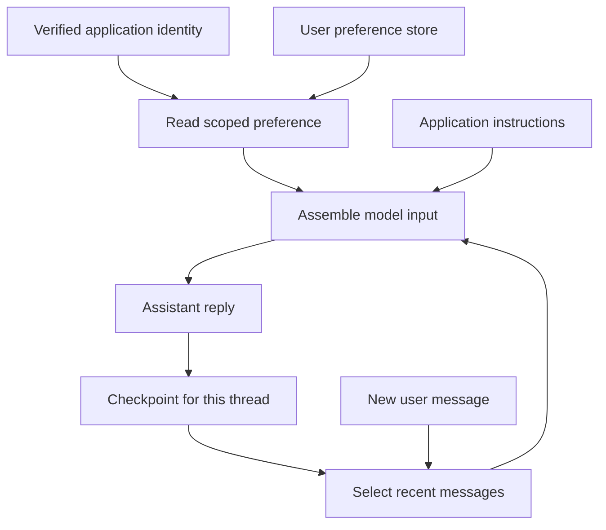

# Conversation Memory and User Context in Agentic AI

## A practical, 60-minute introduction using Python and LangGraph

**Audience:** Engineers who are new to agent memory and user context.  
**Prerequisite:** Basic familiarity with Python functions, dictionaries and running a script. No previous LangChain or LangGraph experience is required.  
**Format:** Instructor explanation, three short demonstrations, a guided exercise and discussion.  
**Running example:** An enterprise IT support assistant for fictional employees Ananya and Ravi.  
**Prepared and checked:** 4 November 2026.  
**Teaching time:** Exactly 60 minutes. Installation is completed before the session. Optional extensions are after-class material.

All teaching content is in this Markdown file. All Python implementation is in separate `.py` files. Terminal commands below launch those files; there are no embedded Python programs to copy from the guide.

> **Important for the instructor:** The default demonstrations use real LangGraph graphs, message state, checkpoints and stores, with clearly labelled, deterministic response simulations. They make no LLM calls and need no API key after installation. This makes the memory behaviour easy to inspect. Demo 2 also provides an optional live LangChain chat-model mode. The small workflows demonstrate the memory layer used by agents; they are not complete autonomous IT support agents.

## Learning outcomes

By the end of the hour, participants should be able to:

1. Explain conversation memory, saved user preferences, runtime context and model input in their own words.
2. Continue a conversation using a LangGraph checkpointer and a stable thread identifier.
3. Retrieve an explicitly saved preference in a new conversation for the same user.
4. Keep memory separate for different users and organisations.
5. Explain why storing information does not guarantee that a model can see it.
6. Recognise the effects of trimming, stale preferences and incomplete forgetting.

## The exact 60-minute agenda

| Time | Minutes | Topic | Method and outcome |
|---|---:|---|---|
| 00:00–05:00 | 5 | Why memory matters | Act out a support conversation and identify the information needed for a follow-up. |
| 05:00–13:00 | 8 | Understand memory and context | Distinguish conversation history, user preferences, application identity and model input. |
| 13:00–20:00 | 7 | Map the concepts to LangGraph | Introduce state, nodes, edges, checkpointers, stores and runtime context. |
| 20:00–30:00 | 10 | Demo 1: conversation memory | Compare no memory, the same thread and a new thread. |
| 30:00–41:00 | 11 | Demo 2: user context across conversations | Save, retrieve, correct and forget a preference; check user and tenant separation. |
| 41:00–48:00 | 7 | Guided exercise | Complete two small functions and run five provided scenarios. |
| 48:00–55:00 | 7 | Select and maintain useful context | Run Demo 3; explain trimming, summaries and memory boundaries. |
| 55:00–60:00 | 5 | Recap, knowledge checks and questions | Verify the key distinctions and answer questions. |
| **Total** | **60** | | **Exactly 60 minutes, including explanation, demonstrations, guided practice and questions.** |

**Pacing rule:** Teach Sections 1–8 during the hour. Use setup and the appendices as preparation or reference. Do not install dependencies or run the optional extensions during the teaching hour. If a participant has an environment problem, let them follow the instructor's output and complete the exercise afterwards.

## Before the session: setup and file map

### What participants need

Use Python 3.11 or 3.12, a terminal and a text editor. The package was executed with Python 3.12.14. Internet access is required to install dependencies; the default teaching path then runs locally without a model service. The optional live mode requires an approved provider account, an API key and an available chat model.

Extract the complete package into one folder. Keep the Python files together because the SQLite extension imports Demo 1. Open a terminal in that folder.

| Step | macOS / Linux | Windows PowerShell |
|---|---|---|
| Check Python | `python3 --version` | `py --version` |
| Create an environment | `python3 -m venv .venv` | `py -m venv .venv` |
| Activate it | `source .venv/bin/activate` | `.venv\Scripts\Activate.ps1` |
| Install the core dependencies | `python -m pip install -r requirements.txt` | `python -m pip install -r requirements.txt` |
| Check that the first demo runs | `python demo_01_thread_memory.py` | `python demo_01_thread_memory.py` |

If PowerShell blocks activation, use `.venv\Scripts\python.exe` in place of `python` in the install and run commands. There is no need to change machine-wide execution policy. On macOS/Linux, `.venv/bin/python` works without activation.

Use an environment without tracing enabled for the offline workshop. For an instructor's dedicated environment, the settings `LANGSMITH_TRACING=false` and `LANGCHAIN_TRACING_V2=false` disable the usual opt-in LangChain tracing paths. Do not paste API keys into the teaching files or projector output.

### Files and when to use them

| File | Purpose | When |
|---|---|---|
| `Conversation_Memory_and_User_Context_60_Minutes.md` | Complete instructor and participant guide | Whole session |
| `demo_01_thread_memory.py` | Message state, checkpoints and separate conversations | 20:00–30:00 |
| `demo_02_user_context.py` | Explicit preferences, runtime identity, stores, update and delete | 30:00–41:00 |
| `exercise_context.py` | Two TODO functions for participants | 41:00–48:00 |
| `solution_context.py` | Completed exercise and scenario checks | Instructor recovery/reference |
| `demo_03_context_budget.py` | Selected model input versus stored history | 48:00–55:00 |
| `optional_sqlite_restart.py` | Conversation persistence across separate processes | After class |
| `requirements.txt` | Tested core dependency versions | Before class |
| `requirements_optional.txt` | Optional live-model and SQLite dependencies | After class |
| `requirements_verified_lock.txt` | Exact environment used for verification | Reproduction reference |

The exercise starter intentionally raises `NotImplementedError` until its two TODOs are completed. That is the exercise, not an installation failure. The completed solution should end with five successful scenario checks.

### Instructor preparation

Run the three demos and the completed solution once. Keep the editor and terminal side by side. Open Demo 1 at `build_graph`, Demo 2 at `UserContext` and `memory_namespace`, and the exercise at its two TODO functions. Explain each concept before displaying its implementation.

The core versions actually executed are LangGraph **1.2.19**, LangChain Core **1.7.5** and LangGraph Checkpoint **4.3.1**. The optional packages checked are LangGraph Checkpoint SQLite **3.1.3** and LangChain OpenAI **1.7.3**. These are tested versions, not a promise that they will remain the latest releases. The lock file records the complete verification environment, including optional dependencies.

---

## 1. Why memory matters

**Time: 00:00–05:00. Outcome: participants can identify what a follow-up depends on.**

### Start with a familiar conversation

Say:

> Ananya contacts the IT helpdesk: “My VPN keeps disconnecting. I use Windows 11, and I have already restarted the VPN client.” A minute later she asks, “What should I try next?”

Ask the room: **“If the assistant receives only the second sentence, what information is missing?”**

Expected answers include the problem, the operating system and the action already attempted. A useful assistant should avoid asking the same basic questions again or immediately recommending the step Ananya has already tried.

Now extend the story:

> On another day, Ananya asks about a printer. She still prefers brief, numbered instructions. Should the printer conversation receive the entire VPN conversation?

The desired behaviour is to use the relevant preference while keeping the unrelated incident history out of the new conversation.

### Explain what the application does

A model response depends on the information supplied for that request. A surrounding application or service may retain previous interactions, but a developer should not assume that a new model request automatically includes the right history. The application must preserve, retrieve and select what is needed.

In this module, “remembering” means managing information outside the model and making it available when appropriate. It does not mean retraining the model or changing its weights. LangGraph supports thread memory through graph state and checkpoints, and cross-conversation information through stores. [1][2]

**Instructor bridge:** “We need one place for the current conversation, another place for selected user preferences, and a deliberate way to choose what the assistant sees.”

**Minute 4–5 check:** Ask participants to name one fact that belongs to the current support incident and one preference that could be useful in a later incident.

---

## 2. Understand memory and context

**Time: 05:00–13:00. Outcome: participants can distinguish four commonly confused ideas.**

### 2.1 Four ideas, with helpdesk analogies

| Idea | Plain meaning | Helpdesk analogy | Example in this lesson |
|---|---|---|---|
| Conversation memory | Messages and working information belonging to one conversation | The current support ticket | Ananya uses Windows 11 and has already restarted the client. |
| Saved user context | Selected facts or preferences that may be useful across conversations | A small customer preference card | Ananya explicitly asked for brief instructions. |
| Runtime context | Information supplied by the application for this particular invocation | The verified employee badge and application configuration | Which organisation and employee are making the request. |
| Model input context | The selected information actually supplied for this response | The documents placed on the helpdesk agent's desk | Instructions, relevant preference and recent conversation messages. |

Runtime context and model input context are different. A user identifier can help application code retrieve a preference without being included in the prompt. Passing a value as LangGraph runtime context does not automatically make that value visible to the model. [3]

### 2.2 One user can have many conversations

Introduce these identifiers in words before opening code:

| Identifier | Identifies | Example | Normally changes when a new chat starts? |
|---|---|---|---|
| Tenant ID | An organisation or customer account | `acme` | No |
| User ID | An employee within that organisation | `ananya` | No |
| Thread ID | One conversation or workflow history | A particular support conversation | Yes |

“Tenant” is a software term for an organisation or customer whose data must remain separate from other customers' data. Two organisations may both have a user called `ananya`. Their saved information must remain separate.

The demo derives its thread identifier from the tenant, user and conversation label. This avoids accidental collisions in the example. It is not an authentication system. In a deployed service, the server must verify who is calling and whether they own the requested conversation before reading it.

### 2.3 Short term and long term describe scope

**Thread memory:** useful within one conversation. It can last beyond a program restart if the checkpointer uses durable storage.

**Cross-conversation memory:** information intentionally available across multiple threads. An in-memory implementation can demonstrate this scope while still losing its contents when the process stops.

Do not equate “short term” with RAM or “long term” with a database. Scope and storage durability are separate design choices. [2][4]

| Situation | Conversation history | Saved preference |
|---|---|---|
| Same user, same thread | Reuse that thread's history | Look up that user's current preference |
| Same user, new thread | Begin with a separate history | Look up the same user's preference |
| Different user | Use that user's authorised thread | Use that user's own preference |
| Same user ID, different tenant | Use the other tenant's authorised thread | Use the other tenant's separate record |
| Restart with only in-memory backends | Lost | Lost |

### 2.4 Where organisational knowledge fits

A company VPN policy or troubleshooting manual belongs in a knowledge source. Retrieving relevant parts of that source is often called retrieval-augmented generation, or RAG. It answers “what does the organisation know?” Conversation memory answers “what has happened in this conversation?” A user profile answers “what relevant preference has this user chosen?”

These can be combined in a larger agent, but this hour does not need a vector database, embeddings or a document pipeline. A known preference can be retrieved by its exact key. LangGraph's in-memory store supports optional semantic search, but embeddings are not required for the exact lookups used here. [4][8]

**Minute 12–13 check:** “If Ananya starts a new chat, which identifier changes, and which information should still be available?”

Expected answer: the thread changes; the authenticated identity can stay the same, allowing the application to look up her approved preference.

---

## 3. Map the concepts to LangGraph

**Time: 13:00–20:00. Outcome: participants can explain the pieces of a minimal graph.**

### 3.1 A graph is a small workflow

LangGraph describes a workflow using **state**, **nodes** and **edges**. A node is a Python function that does some work. State is the information available to that work. An edge determines what runs next. In our examples there is one assistant node between the start and end of the workflow. It is deliberately small so that the memory mechanisms are visible. [5]

| Component in the Python files | What to tell a beginner |
|---|---|
| `StateGraph` | Builds the workflow. |
| `MessagesState` | Holds the conversation's message list and defines how message updates are merged. |
| `HumanMessage` | One message from the user. |
| `AIMessage` | One reply from the assistant. |
| `SystemMessage` | Application instructions supplied to the model in live mode. |
| `START` and `END` | The workflow's entry and exit. |
| `compile` | Turns the graph definition into something that can run and attaches memory backends. |
| `invoke` | Runs the graph for an input. |
| `InMemorySaver` | Holds checkpoints for separate threads in the running process. |
| `InMemoryStore` | Holds named records that can be shared across threads. |
| `Runtime` and `context_schema` | Let a node access application-supplied context and the configured store. |

Explain the type annotations only as needed. `UserContext` is a small container for tenant and user identifiers. `MessagesState` describes the message state. Participants do not need to learn all Python typing features in this lesson.

### 3.2 Follow the information, not just the reply

The diagram shows the live-response path. An explicit preference command additionally writes or deletes a record in the store. The offline demos substitute a clearly identified scripted response for the model call; LangGraph still performs the actual state and store operations.

### 3.3 What happens on a follow-up

1. The application selects an authorised conversation and supplies the new user message.
2. The checkpointer restores that thread's graph state.
3. `MessagesState` merges the new message into the history.
4. The node reads the relevant state and, when needed, the scoped preference.
5. The node produces one new reply. LangGraph merges the update and checkpoints the resulting state.

The message reducer also handles message IDs. A new message is added; an update with an existing message ID can replace that message. For this lesson, submit only the new user message and return only the new assistant message. Rebuilding and resubmitting old messages with fresh IDs can duplicate history. [5]

**Teaching emphasis:** A checkpointer restores state. The node still decides what information to use. Saving state is not the same as sending the entire state to a model. [1]

---

## 4. Demo 1: remember this conversation

**Time: 20:00–30:00. File: `demo_01_thread_memory.py`.**

### Run

Run `python demo_01_thread_memory.py` from the workshop folder.

The script uses the deliberately simple fact “I use Windows 11” and then asks “Which operating system did I mention?” This removes ambiguity from the observed result. Its response function recognises a small set of operating-system mentions; it is not a general language model.

### Ten-minute teaching sequence

| Minutes within this segment | Instructor action |
|---|---|
| 0–2 | Open `assistant` and `build_graph`. Identify the message state, the one node, the edges and the optional checkpointer. |
| 2–5 | Run the script. Compare case A without a checkpointer against case B with `InMemorySaver`. |
| 5–7 | Inspect case C, where only the thread changes. Ask learners to predict the result before reading it. |
| 7–9 | Show the final `get_state` inspection. Count user and assistant messages. |
| 9–10 | Ask the diagnostic question below. |

### What participants should observe

| Case | Configuration | Expected answer to the follow-up | Messages in that returned state |
|---|---|---|---:|
| A | No checkpointer; same thread label supplied | “I cannot find an operating system in this conversation.” | 2 |
| B | One reused `InMemorySaver`; same thread | “You mentioned Windows 11.” | 4 |
| C | Same graph and saver; different thread | “I cannot find an operating system in this conversation.” | 2 |

The four messages in case B are: the initial user statement, the assistant acknowledgement, the user follow-up and the assistant answer. Case C does not erase case B. The original thread still has its four messages.

### Explain the cause

Case A proves that a thread label alone does not provide memory. Case B attaches a saver and reuses the same thread, allowing LangGraph to recover the earlier message. Case C selects a different conversation, so that earlier message is absent.

The demo creates its saver once and reuses the compiled graph. Recreating an in-memory saver on every request would create empty storage each time. A process restart also loses its contents. [2]

### Diagnostic question

**“Did changing the thread identifier change Ananya's identity?”**

No. A thread identifies a conversation. User identity is a separate concern. This first demo does not yet implement a user profile or an authentication layer.

**Instructor takeaway to say aloud:** “Same thread plus the same checkpoint backend gives conversation continuity. A new thread starts a separate conversation.”

---

## 5. Demo 2: remember an approved user preference

**Time: 30:00–41:00. File: `demo_02_user_context.py`.**

### Run

Run `python demo_02_user_context.py`.

The default mode is offline. The script prints the preference selected from the store before producing each simulated printer-support reply.

### 5.1 Introduce the preference record

Ananya explicitly asks the assistant to remember a response style. The demo uses a simple command so that the intent is unambiguous: `/remember style=brief`.

| Part | Value or meaning |
|---|---|
| Tenant | `acme` |
| User | `ananya` |
| Namespace | Five ordered parts: `tenants`, `acme`, `users`, `ananya`, `preferences` |
| Record key | `response_style` |
| Allowed value | `brief` or `detailed` |
| Source | `explicit_user_request` |
| Update time | The time this preference was saved |

A **namespace** groups records under a scope. A **key** identifies a record within that scope. The store returns an item whose `value` contains the saved dictionary. The demo reads one known key rather than searching the entire store. [4]

The source and timestamp help a developer understand where a preference came from and when it changed. The demonstration does not implement automatic expiry or a complete audit history.

### 5.2 Walk through the code in five stops

1. **`UserContext`:** the application supplies the tenant and user identifiers. In this script these are fictional fixtures representing an already authenticated caller.
2. **`memory_namespace`:** both identifiers determine which preference record is accessible to this lookup.
3. **Explicit commands:** only an allowed response-style value is written. The program does not silently infer personal facts from every message.
4. **`read_style`:** each normal request retrieves the current preference, falling back to `default` when there is no valid record.
5. **`build_graph` and `invoke_turn`:** the graph receives both a checkpointer and a store; each invocation receives runtime context and a scoped thread configuration.

In live mode, the application maps the allowed preference to fixed response-format instructions. It does not copy arbitrary text from a memory record into a privileged instruction. The conversation messages are selected separately.

### 5.3 Observe the six cases

| Case | What changes | Expected observation |
|---|---|---|
| A | Ananya saves `brief` in conversation one | The store contains the new preference. |
| B | Ananya opens conversation two | The selected preference is `brief`; this new transcript contains only two messages. |
| C | Ravi asks the same printer question | The selected preference is `default`. |
| D | User ID `ananya` appears under tenant `beta` | The selected preference is `default`. |
| E | Ananya changes her preference to `detailed` | A fresh conversation selects `detailed`. |
| F | Ananya requests `/forget style` | The preference record is deleted; a fresh conversation selects `default`. |

For case B, pause on the message count. Ananya's preference is available even though the new conversation does not contain the earlier `/remember` message. That is the visible difference between sharing a profile and copying a transcript.

For cases C and D, explain that user separation and organisation separation are distinct. Including only a user ID can be insufficient in an application that serves multiple organisations.

### 5.4 Correction and forgetting

The second explicit preference write uses the same key, replacing the earlier value. A fresh lookup therefore returns the current preference. The application should not keep using a stale copy indefinitely.

Deleting the profile record does not delete the earlier command from its conversation. It also does not prove that every old checkpoint, trace or backup has been erased. Case F uses a **new conversation** so that the removed preference is not also present in that conversation's earlier messages.

The default response mode is a deterministic demonstration. A live model may phrase its answer differently. Assess the selected preference and stored state separately from the exact wording of generated prose.

### Eleven-minute pacing

Use 2 minutes to introduce the namespace, 3 minutes for saving and the new conversation, 2 minutes for user/tenant separation, 2 minutes for correction and forgetting, and 2 minutes for questions and code inspection.

**Check:** “Why can conversation two use the preference even though it does not include conversation one's messages?”

Expected answer: the node explicitly retrieves the preference from a user-scoped store shared across threads.

**Durability reminder:** Both `InMemorySaver` and `InMemoryStore` are in RAM in this demo. The user preference survives a change of thread within this process, not a process restart. [2][8]

---

## 6. Guided exercise: retrieve the right user's preference

**Time: 41:00–48:00. Starter: `exercise_context.py`. Solution: `solution_context.py`.**

### The task

The supplied graph, messages, store fixtures and scenario runner are already implemented. Complete only two functions:

1. **`memory_namespace`:** return the five namespace parts in this order: `tenants`, the tenant ID, `users`, the user ID, `preferences`.
2. **`read_response_style`:** read the `response_style` record from that namespace. If the record is missing, return `default`. If the saved value is `brief` or `detailed`, return that value. Otherwise return `default`.

Use the patterns demonstrated in Demo 2. The saved record is a store item; its dictionary is available through `item.value`. The namespace must come from runtime context, not from the user's chat sentence.

### Time allocation

| Minute | Participant action |
|---|---|
| 0–1 | Read the two TODOs and predict the scenario results. |
| 1–4 | Complete the two functions. |
| 4–6 | Run `python exercise_context.py` and check the results. |
| 6–7 | Explain to a neighbour why the preference is available in a new thread but unavailable to another user. |

### Acceptance criteria

| Scenario | Required result |
|---|---|
| Ananya, first conversation | `response_style=brief` |
| Ananya, new conversation | `response_style=brief` |
| Ravi, same company | `response_style=default` |
| User ID Ananya, different company | `response_style=default` |
| A deliberately invalid saved style | `response_style=default` |

Each scenario should contain its own two-message conversation. All five checks must pass. Missing memory must not crash the graph.

### Instructor support

If the lookup fails, ask: “Does your namespace match every part of the saved record's namespace?” If it returns an object instead of a style, ask: “Where is the item's value dictionary?” If Ravi receives Ananya's style, inspect whether the user or tenant was omitted.

At minute 47, stop editing. Run `python solution_context.py` if needed and discuss the result. Do not extend the exercise into the next segment.

**What to submit after class, if this session is assessed:** the completed `exercise_context.py`, its five `PASS` results and a two-sentence explanation of why a thread ID cannot replace a user/tenant namespace. Do not submit API keys or real employee data.

---

## 7. Select and maintain useful context

**Time: 48:00–55:00. File: `demo_03_context_budget.py`.**

### 7.1 Storage is bigger than the information used for one answer

Run `python demo_03_context_budget.py`.

The script starts with a fictional conversation containing 15 messages. An early message says “I use Windows 11.” Later messages discuss a printer. The final question asks which operating system was mentioned.

LangChain's `trim_messages` selects a recent portion of the history using an approximate token allowance. The node constructs a candidate model input from the system instruction and that selected history. Its simulated response then demonstrates what information is available. The complete history remains in the graph. [1][6]

| Output from the tested version | Meaning |
|---|---|
| 15 messages before the reply | All supplied conversation messages are in state. |
| 3 selected history messages | Only a recent portion fits this selection policy. |
| 237 approximate tokens allowed for history | The budget after reserving other parts of the request. |
| The simulated answer asks for the operating system again | The early fact was excluded from the selected input. |
| 16 stored messages after the reply | The full history plus the new answer is still stored. |

This is a deliberately visible failure mode. Recency alone can drop an important fact. The correct reaction is to improve context selection or ask for clarification, rather than assume that saved information must already be visible to the model.

### 7.2 Explain the token budget simply

A token is a unit a model uses to represent text or other input; it is not reliably the same as a word. A request needs room for instructions, the current task, retrieved material if any, conversation history and the model's response.

**History allowance = model context allowance − instructions/profile/retrieved inputs − response allowance − safety margin.**

For the classroom script, the numbers are intentionally small: a total allowance of 384, a response reserve of 96, a safety margin of 32 and approximately 19 tokens for the system instruction. That leaves approximately 237 for history, including the latest user message. These are teaching numbers, not the specifications of a real model.

Approximate counting is useful for demonstrating selection. It is not an exact provider token count or a billing calculation. A deployed application must budget for its actual model and all inputs, including tool definitions, tool results and multimodal content when present. [7]

### 7.3 Three ways to manage growing history

| Approach | What it does | Trade-off to explain |
|---|---|---|
| Recent-message selection | Keeps a bounded recent part of the conversation | Simple, but may omit an important earlier fact. Implemented in Demo 3. |
| A checked summary or structured task facts | Preserves key information compactly, such as the problem, OS and steps already tried | Can lose detail or become stale; needs correction and validation. Discussed, not implemented here. |
| Relevant-memory retrieval | Selects information related to the current request | Needs good scope and relevance checks; large collections may benefit from search. Exact profile retrieval is implemented in Demo 2. |

A useful support summary might record: “VPN disconnects; Windows 11; client restarted; issue unresolved.” It should not silently turn “I might be using Windows 11” into a confirmed fact. Preserve uncertainty and check corrections against the underlying record when needed.

Trimming a list for model input is not deletion from state. Even removing a message from the current state does not by itself erase earlier checkpoint snapshots. [1][9]

### 7.4 Four practical memory boundaries

Use the remaining two minutes for these principles, illustrated by the existing examples:

1. **Identity comes from the application.** A message saying “I am Ravi” or “I am an administrator” does not grant access to Ravi's records or administrative tools. Namespaces select data; authentication and authorisation must protect those selections.
2. **Remember deliberately.** In this lesson, an explicit command stores an allowed preference. An application that extracts facts automatically also needs validation, provenance, correction and a policy for what should be retained.
3. **Use relevant, current information.** A response preference can help with a printer question; a complete old VPN transcript usually does not. A fresh explicit correction should update the relevant record. Permissions and other changing facts should be checked against their authoritative system when used.
4. **Explain the scope of forgetting.** Deleting a profile entry, removing a current message, deleting a thread's checkpoints and managing logs/backups are different operations. The demo's `/forget style` only deletes the preference record.

These are architecture recommendations for this workshop, not claims that the supplied scripts implement a production security or retention system.

### Seven-minute pacing

Spend 2 minutes running and reading the demo, 1 minute on the budget, 2 minutes comparing selection strategies and 2 minutes on the four boundaries.

---

## 8. Recap, knowledge checks and questions

**Time: 55:00–60:00.**

Use the first three minutes for the following questions and the final two minutes for participants' questions. These are verbal checks; no separate quiz application is required.

### Question 1

**Ananya starts a new conversation. What changes, and what may still be available?**

The thread changes and has a separate history. Her identity can remain the same, so the application can retrieve her saved preference from the appropriate namespace.

### Question 2

**The application saved the full conversation. Why might the assistant still ask for the operating system again?**

The model might not have received the message containing it. Storage and selected model input are different. Demo 3 excluded the early fact while retaining it in checkpointed state.

### Question 3

**Ananya deletes her saved response preference. Has every copy of that information disappeared?**

No. The profile record is removed, but earlier conversation messages, checkpoint history and other retained records may still contain it.

### One-sentence architecture explanation

Ask one participant to complete this statement:

> “The checkpointer restores the current conversation; the store supplies a scoped user preference; runtime context identifies the caller to the application; and the node selects what goes into the model request.”

Close with the practical outcome: participants can now recognise and implement the basic memory components of an agent, and can explain their different scopes and limitations.

---

## Appendix A. Optional extensions, outside the 60-minute session

### A1. Use a real LangChain chat model in Demo 2

Install the optional dependencies with `python -m pip install -r requirements_optional.txt`.

Set `OPENAI_API_KEY` through your usual environment or secret-management process. Use a chat model identifier that is available to your account. Then run `python demo_02_user_context.py --live --model YOUR_AVAILABLE_MODEL_ID`, replacing the final placeholder with that identifier.

The memory writes, lookups, namespaces, thread handling and deletions are unchanged. For the five normal support questions in the scripted scenario, the node now calls LangChain's `ChatOpenAI`; memory-management commands are still handled directly by the application. Model calls require network access and may incur provider charges. Output wording can vary.

The script uses a 700-token approximate history allowance for this optional demonstration. Confirm that the chosen model has adequate room for instructions, that history and its output. It is a simple teaching allowance, not a general adaptive budget manager.

The optional mode's imports and prompt assembly were checked locally using an instrumented response stub. A live provider call was not executed during package verification, so provider access and generated-answer quality remain to be checked in the instructor's environment. The default class does not depend on this mode.

**After-class question:** Which part of the program changed when the simulated reply was replaced with a model? Answer: the response-generation call. The explicit memory plumbing remained in place.

### A2. Preserve a conversation across process restarts

Install the optional requirements first, then run the following as three separate terminal commands, in order:

| Step | Command | Expected result |
|---|---|---|
| Write the first turn | `python optional_sqlite_restart.py write` | Save the Windows 11 statement to a local SQLite checkpoint database. |
| Start a new Python process and ask the follow-up | `python optional_sqlite_restart.py read` | Recover the same thread and recall Windows 11. |
| Clear this example's thread | `python optional_sqlite_restart.py reset` | Delete checkpoints for the workshop thread only. |

The database is created in `.workshop_data/checkpoints.sqlite` beside the script. The script also accepts `--db` with a chosen path. A read before a successful write produces an explanatory error.

`SqliteSaver.from_conn_string` is used as a context manager, and graph execution happens while the connection is open. A file-backed SQLite saver can retain thread state across processes; an in-memory SQLite connection would not provide that behaviour. [10]

This extension persists **conversation checkpoints only**. It does not turn Demo 2's `InMemoryStore` into a persistent user-profile database. A production application may use a durable LangGraph store as well as a durable checkpointer. [2][4]

### A3. Follow-on design tasks

After the class, choose one focused extension: add a validated language preference; define an expiry policy for temporary user context; preserve the current support problem as a checked summary; or replace the in-memory store with a suitable persistent backend.

For a larger agent, also consider how tools and subagents receive only the context they need. Preserve the relationship between a tool call and its result when trimming tool conversations. The simple trimming demo contains only human and assistant messages and does not implement that additional selection logic. [6]

---

## Appendix B. Troubleshooting

| Symptom | Likely explanation | What to do |
|---|---|---|
| `No module named langgraph` | Dependencies were installed into another Python environment. | Activate the intended environment and use `python -m pip install -r requirements.txt`. |
| Demo 1 does not retain a fact after restarting the script | Its checkpointer is in RAM. | That is expected; use the separate SQLite extension to demonstrate restart persistence. |
| A new conversation does not have old messages | It has a different thread identifier. | Expected. Use the original thread for continuity; use the store for selected cross-thread information. |
| A preference appears to be missing | Namespace or key differs from the saved record, or the store was recreated. | Inspect tenant, user, namespace parts, key and object lifetime. |
| Old messages appear twice in modified code | Prior history was resubmitted with new message IDs. | Submit only the new message on each follow-up and return only new node updates. |
| Exercise raises `NotImplementedError` | One of the intentional TODOs is unfinished. | Complete the two functions or review `solution_context.py`. |
| The saved value is an item object | The lookup returns a store item. | Read its `value` dictionary and then the preference value. |
| SQLite import fails | Optional requirements are not installed. | Install `requirements_optional.txt` in the same environment. |
| SQLite read says to write first | There is no saved workshop thread at that path. | Run the write action first, using the same database path. |
| Live mode requests an API key or model | Required live configuration is missing. | Supply an available model and environment key, or omit `--live` for the complete offline lesson. |
| A provider reports authentication, model or network errors | Live access has not been configured successfully. | Check the instructor's provider configuration; continue the class in offline mode. |
| Latest message is larger than the trimming allowance | The demo intentionally avoids silently splitting it. | Ask for a shorter request or revise the input-budget policy. |

---

## Appendix C. Glossary

| Term | Meaning in this session |
|---|---|
| Agent | An application that uses a model and other components to pursue a task; memory is one component. |
| State | Working information available to graph nodes. |
| Node | A function that performs work in the graph. |
| Edge | A connection that determines which node runs next. |
| Message | One user, assistant, system or tool communication. |
| Reducer | The rule for merging a node's update into a state field. |
| Thread | One conversation or workflow history. |
| Checkpoint | A saved snapshot of graph state at a point in execution. |
| Checkpointer | The component that saves and restores thread checkpoints. |
| Store | A component for application-defined records accessible across threads. |
| Namespace | Ordered scope identifiers used to organise store records. |
| Tenant | An organisation or customer account whose information must be separated from others. |
| Runtime context | Application-supplied information and dependencies for an invocation. |
| Model context | The information actually supplied to the model for a response. |
| Token budget | The allowance for different parts of a model request and its response. |
| Trimming | Selecting a smaller portion of messages for use in a request. |
| Provenance | Information about where a remembered fact or preference came from. |

## Appendix D. Verification and practical limits

The package is designed around observable memory behaviour. Its checks cover same-thread recall, separate threads, preference reuse, different users, different tenants, preference correction and deletion, invalid/missing profile fallbacks, history selection without state deletion, and checkpoint recovery across separate processes.

The example identity values represent a caller already authenticated by an application. The scripts do not implement sign-in, a production authorisation layer, encryption management, retention scheduling or concurrent updates from multiple workers. Their deterministic replies are narrow teaching simulations. These limits keep the class focused on memory and context within one hour.

The verification lock file records the exact installed environment. The shorter requirements files pin direct dependencies for an easier classroom setup. Platform-specific dependency availability can differ; use Python 3.11 or 3.12 and rehearse in the participants' environment.

## Appendix E. Official references

Sources checked on 4 November 2026. The explanations, examples, exercise and teaching schedule are original workshop material; these primary sources document the framework behaviour used by the implementation.

1. [LangGraph: Memory](https://docs.langchain.com/oss/python/langgraph/add-memory) — adding conversation memory and selecting model input.
2. [LangGraph: Persistence](https://docs.langchain.com/oss/python/langgraph/persistence) — thread checkpoints, stores and backend lifetime.
3. [LangChain: Context overview](https://docs.langchain.com/oss/python/concepts/context) — runtime context versus model context.
4. [LangGraph: Stores](https://docs.langchain.com/oss/python/langgraph/stores) — cross-thread records, namespaces and store operations.
5. [LangGraph: Graph API overview](https://docs.langchain.com/oss/python/langgraph/graph-api) — state, nodes, edges, message reducers and runtime context.
6. [LangChain Core: trim_messages](https://reference.langchain.com/python/langchain-core/messages/utils/trim_messages) — trimming rules and message-structure considerations.
7. [LangChain Core: count_tokens_approximately](https://reference.langchain.com/python/langchain-core/messages/utils/count_tokens_approximately) — approximate counts and their limitations.
8. [LangGraph: official InMemoryStore implementation](https://github.com/langchain-ai/langgraph/blob/main/libs/checkpoint/langgraph/store/memory/__init__.py) — in-process storage and optional embedding configuration.
9. [LangGraph: Checkpointers](https://docs.langchain.com/oss/python/langgraph/checkpointers) — checkpoint history, state inspection and persistence operations.
10. [LangGraph Checkpoint SQLite: official package](https://pypi.org/project/langgraph-checkpoint-sqlite/) — file-backed SQLite checkpoint implementation and usage.
